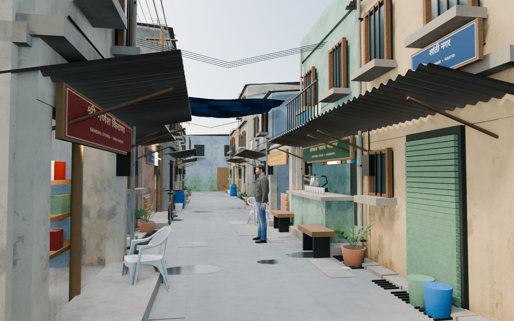

# slumDog

An editable Blender character and a Mumbai-inspired environment study.



## Open the project

Use Blender 4.0 or a compatible newer version. All textures used by the saved scenes are packed into their `.blend` files.

- **Environment:** [environment/Shanti_Nagar_Level.blend](environment/Shanti_Nagar_Level.blend)
- **Character:** [character/Rook_Rebuilt.blend](character/Rook_Rebuilt.blend)
- **Environment video:** [previews/environment_walkthrough.mp4](previews/environment_walkthrough.mp4)
- **Smoking video:** [previews/smoking_animation.mp4](previews/smoking_animation.mp4)

Press **Numpad 0** for the active camera and **Space** to play. Material Preview shows textures; Rendered mode shows the final lighting and procedural smoke.

## Environment

Shanti Nagar is a fictional Mumbai-inspired basti informed by Dharavi references. The first detailed section contains a roughly 28-metre lane, tea stall, local shops, residential fronts, and an adjoining workshop courtyard. Surrounding buildings suggest a larger neighbourhood. Local-language signage, tin awnings, roof additions, water tanks, service cables, drains, washing, and household props establish the setting.

The walking-height camera moves through the street to the courtyard. Named collections separate architecture, infrastructure, props, the character, lighting, cameras, and preliminary collision volumes. This is an editable environment scene; game-engine integration, navigation, varied crowds, sound, and further neighbourhood expansion are future work.

[Environment notes and credits](environment/README.md) · [Tea-stall still](previews/tea_stall.png) · [Courtyard still](previews/courtyard.png)

## Character

Rook has a continuous anatomical body mesh, normalized skin weights, hand and foot IK, finger joints, and facial bones. His nine-second action raises the cigarette from idle to the lips, holds a draw, lowers the hand, exhales, and returns to idle. The ember brightens during the draw. Smoke uses animated volume fields with no external simulation cache.

The character is also placed beside the environment's tea stall. The lightweight environment video uses simplified effect settings; the native scene retains the editable smoke.

[Rig controls and source details](character/README.md) · [Portrait](previews/character_portrait.png) · [Full body](previews/character_fullbody.png)

## Rebuild from source

Run from the repository root with Blender 4.0's Python:

```sh
blender -b --python character/build.py
blender -b --python environment/build_level.py
```

Each build saves its scene and renders review stills. Assets and prebuilt signage are included. To regenerate the environment signage using normal Python, install `requirements.txt` and run:

```sh
python environment/make_signs.py
```

To render the environment preview frames:

```sh
blender -b environment/Shanti_Nagar_Level.blend --python environment/render_walkthrough.py
```

Intermediate frame sequences, logs, and Blender backup files are ignored by Git.

## Credits and licensing

Original project code is covered by the repository's [MIT license](LICENSE). Third-party assets retain their own licenses: MakeHuman graphical assets and Poly Haven assets are CC0; Noto Sans Devanagari uses the SIL Open Font License. See [CREDITS.md](CREDITS.md), the project-specific notes, and the bundled font license.
